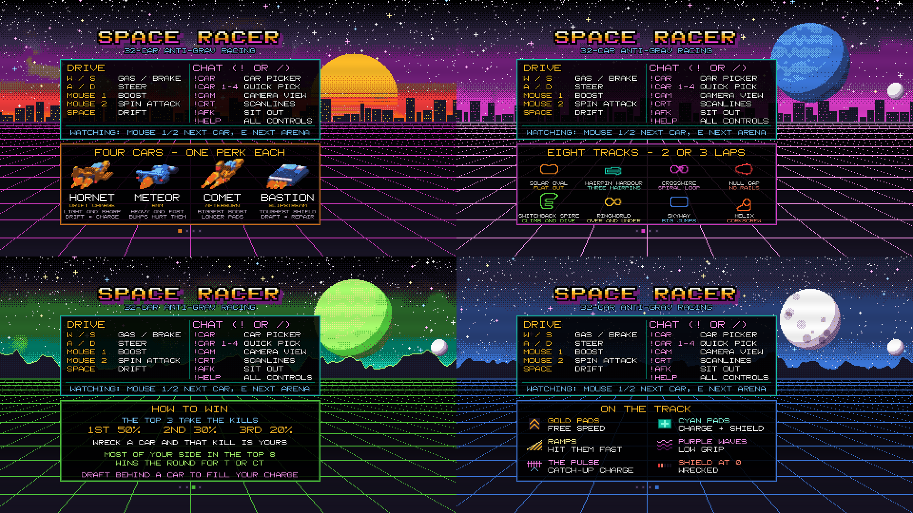
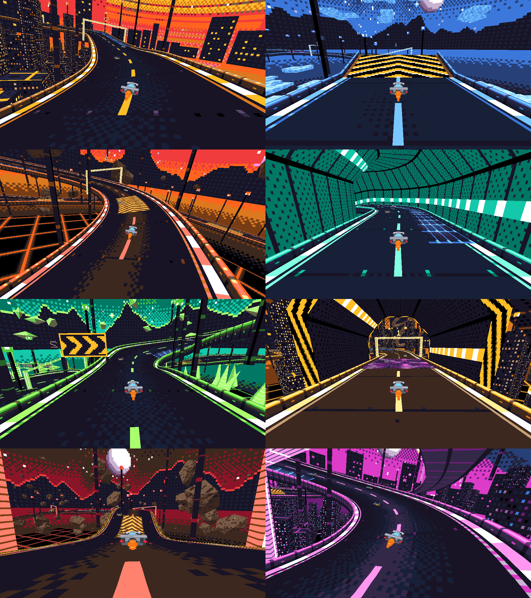
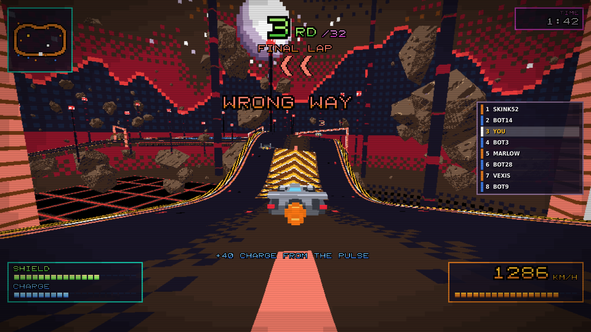
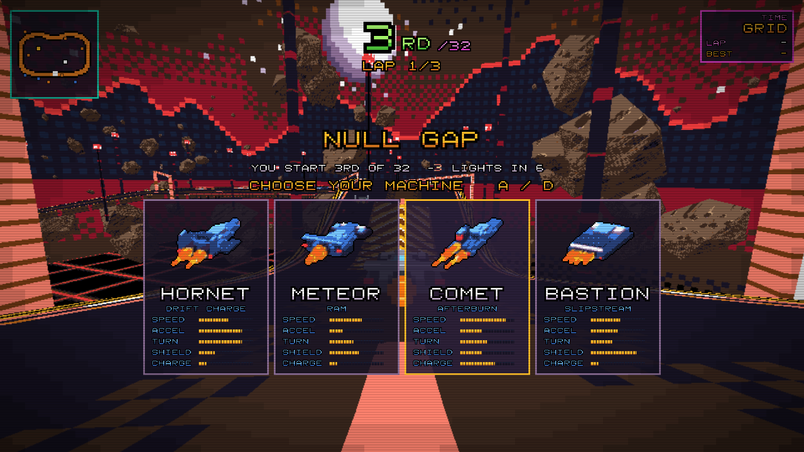
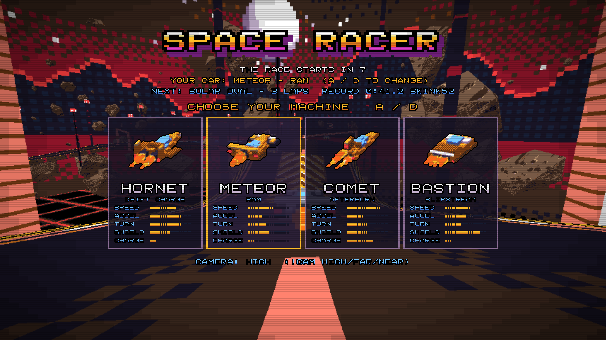
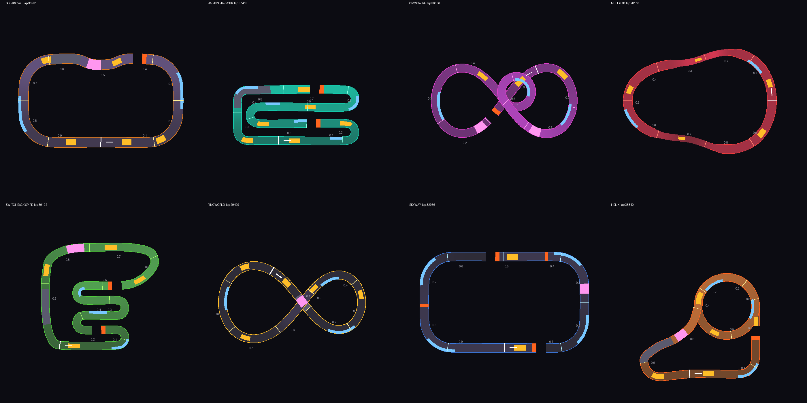
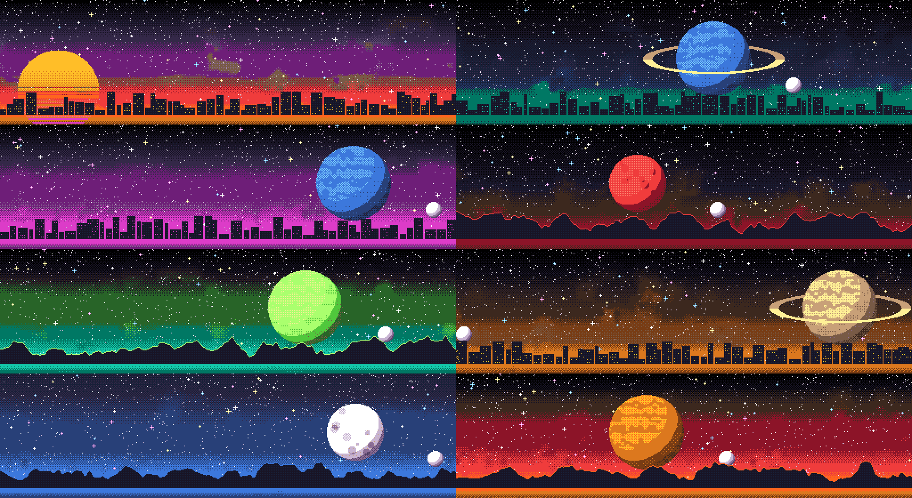
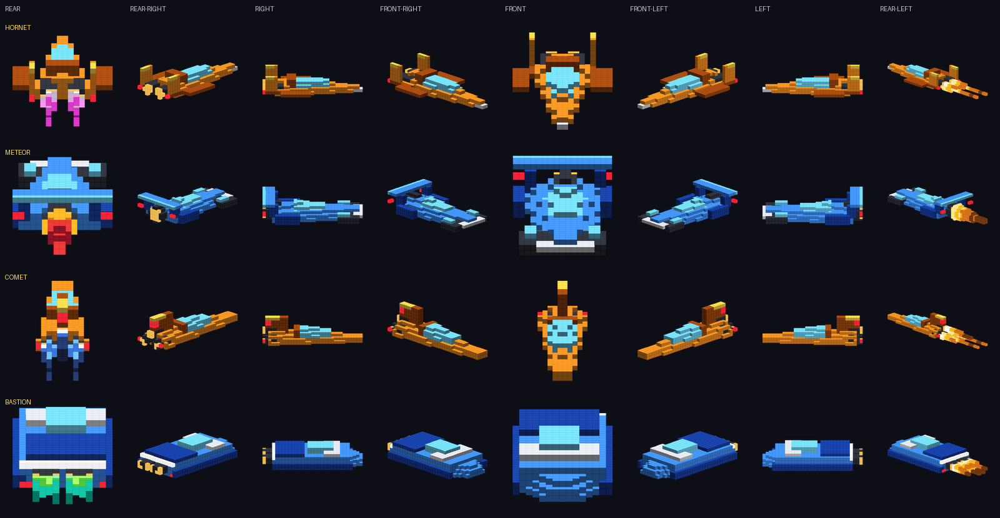

# Space Racer for CS2

A 32-car anti-gravity racing minigame that runs entirely inside one Counter-Strike 2 map as a cs_script, with no
server plugins. Up to 64 players in two 32-car arenas, four cars with different perks, boost pads, charge
platforms, jump ramps, banked bends, tubes, spin attacks, turbo starts, wrecks, the Pulse, eight huge original
tracks, lap records, real CS2 kills for the podium and a T-vs-CT round result from the top 8. Retro: pixel-art
tracks, cities, asteroids and skies in one 32-colour palette, a pixel-font HUD with CRT scanlines, chiptune sound
effects and music - all generated by the tools in this repository.

Workshop: *(link to the Steam Workshop page)*

> **About the code:** the code in this repository (the game, the generators and the build tools) was written by an
> AI coding agent (Claude, by Anthropic). skink52 directed the project, tested it in CS2, did the Hammer work and
> publishes the map, but is not the author of the code. Please keep that in mind when reading or reusing it.

Everything here is original work: the name, cars, tracks, art, sounds and rules. The genre conventions it uses
(anti-grav racers, boost pads, drafting, laps) belong to nobody; see `docs/WORKSHOP_COMPLIANCE.md`.

















## Layout

| Folder | What it is |
|---|---|
| `src/core/` | The game: track maths, car physics, race rules, the driving AI, the round manager. Plain JavaScript with no engine calls, so it runs in Node for tests. |
| `src/cs2/` | The CS2 side: pawn parking and the chase camera, input, prop-pool rendering, HUD, sounds, CS2 kills, round control, chat commands. |
| `tools/` | Generators: `trackdefs.py` (the eight track designs and colour themes), `tracks.py` (tracks → data, road / tube / scenery models, minimaps), `retro.py` (the palette and dithering), `pixfont.py` (the pixel font and logo), `skies.py` (pixel-art skies), `cars.py` (voxel cars, pixel effects, renders), `loading.py` (loading screen, radar, map icon), `hud.py` (Panorama layout/css and glyph pictures), `sounds.py` (chiptune sounds, music and sound events), `vmap.py` (writes the whole map into the Hammer template), `build.mjs` (assembles the script), `build_all.sh`. |
| `test/` | `sim.cjs` runs bot races on the pure game; `mock_cs2.mjs` runs the real script on a stand-in cs_script API; `tsconfig.json` + `point_script.d.ts` type-check it against Valve's API. |
| `preview/` | Pictures of the tracks, skies, cars (`car_angles.png`), loading screen (`loading_all.png`; `loading_cs2.png` sketches where CS2's own column and the 4:3 and 21:9 edges fall), HUD (`hud_render.py` lays the real HUD out like Panorama would, draws it at 16:9, ultrawide and 4:3, and fails the build if a panel breaks the layout rules or sits under CS2's own chat, kill feed, team counter or money / health row; `hud_cs2.png` marks those places), and `chase_view.py`: a software render of the racer's view from the chase camera (sky, banking and all). |
| `docs/` | `DESIGN.md` (the game), `TESTING.md` (first run in CS2), `WORKSHOP_COMPLIANCE.md`, the notes that ship with the addon. |
| `workshop/` | The Steam Workshop page: preview icon, eight screenshots and the description in Steam's BBCode (`workshop/README.md`). |
| `ref/` | The Hammer map template the build writes into, and the stock sound-events file. |

## Building

Needs Python 3 with numpy and Pillow, and Node 18+.

```
sh tools/build_all.sh
```

Output lands in `out/addon/`; copy it into `content/csgo_addons/mg_space_racer/` and build the map in Hammer
(`maps/mg_space_racer.vmap`). `SPR_CURRENT_VMAP=<the map as last saved by Hammer>` makes the build layer its
entities onto that map instead of starting from the template, keeping hand edits. `SPR_NAME=<name>` renames the
map, script and HUD files.

Tests:

```
node test/sim.cjs 64 10            # ten rounds of 64 bots: durations, wrecks, car balance, team points
node test/sim.cjs 64 100 even,seed=71    # car balance: the same number of each car, 200 races
node test/turbo_test.cjs           # the (secret) turbo start's timing
node test/spin_test.cjs            # how far a spin attack shoves each car
node test/mock_cs2.mjs 20 44 500 churn   # the real script on the mock engine with people joining and leaving
cd test && tsc -p tsconfig.json    # type check against point_script.d.ts
```

## Licence

Code: MIT (`LICENSE`). Art, sounds and track designs: CC BY 4.0. Not affiliated with Valve or any racing game.
